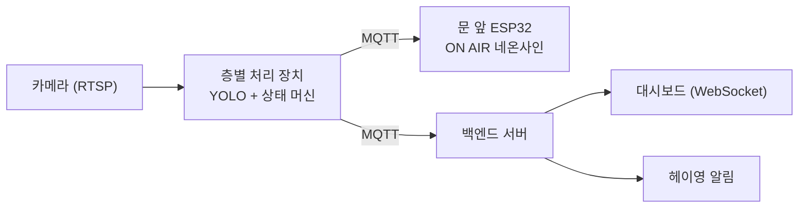

# 빈방 알리미 PR/FAQ

한양대학교 ERICA 오픈스페이스의 빈 방을 YOLO로 감지해서 ON AIR 네온사인과 헤이영 알림으로 알려 주는 프로젝트의 PR/FAQ입니다.

- [Press Release](#press-release)
- [FAQ: 내부 동료가 궁금해할 질문](#내부-동료가-궁금해할-질문)
- [FAQ: 외부 고객이 궁금해할 질문](#외부-고객이-궁금해할-질문)

---

## Press Release

### 1. 제목

**한양대 ERICA '빈방 알리미' 출시: 방 앞의 ON AIR 불이 꺼져 있으면 들어가도 됩니다**

### 2. 부제

한양대학교 ERICA 학생들은 방 앞의 ON AIR 네온사인과 헤이영 알림으로 지금 비어 있는 방을 바로 찾을 수 있고, 학교는 공간을 더 효율적으로 운영하면서 헤이영으로 알리는 학교 행사의 참여도까지 높일 수 있습니다.

### 3. 문제점

시험 기간이 되면 ERICA 오픈스페이스에서는 빈 방을 찾기가 어렵습니다. 방 안에 사람이 있는지는 문을 열어 봐야 알 수 있습니다. 막상 열어 보면 짐만 놓여 있고 사람은 몇 시간째 돌아오지 않는 방도 많습니다. 학생들은 층마다 방문을 하나씩 열어 보며 돌아다니고, 관리자는 모든 방을 순찰할 인력이 부족합니다. 학교는 헤이영으로 행사와 공지 알림을 자주 보냅니다. 하지만 알림이 많다 보니 학생들이 그냥 넘기는 경우가 많아서, 실제 참여로 잘 이어지지 않습니다.

### 4. 솔루션

빈방 알리미는 방마다 설치한 카메라로 방 안에 사람이 있는지 판단합니다. 사람이 있으면 방문 앞의 ON AIR 네온사인이 켜지고, 방이 비면 꺼집니다. 짐만 두고 사람이 60분 넘게 돌아오지 않아도 네온사인이 꺼지고 '이용 가능'으로 바뀝니다. 헤이영에서 빈 방 알림을 신청한 학생에게는 "3층 OO룸이 비었습니다" 같은 알림이 갑니다. 대시보드에서는 층별로 어느 방이 사용 중인지 실시간으로 볼 수 있습니다. 이 시스템은 사람이 누구인지 식별하지 않고, 영상을 저장하지 않으며, 방의 상태만 기록합니다.

### 5. 내부 관계자의 말

> "학생들에게 필요한 정보는 누가 방에 있는지가 아닙니다. 지금 들어갈 수 있는 방이 어디인지입니다. 그래서 처음부터 사람을 식별하지 않고 영상도 남기지 않도록 설계했습니다. 복도에서는 불빛만 보고, 멀리서는 헤이영 알림만 보고 빈 방을 찾을 수 있게 하는 것이 저희의 목표입니다."

### 6. 이용 방법

학생은 다른 앱을 설치할 필요가 없습니다. 복도에서는 ON AIR 불이 꺼진 방에 들어가면 됩니다. 멀리 있을 때는 헤이영의 [빈방 알리미] 메뉴에서 원하는 층을 고르고 '빈 방 나면 알려 주기'를 누르면 됩니다. 전체 상태를 한눈에 보고 싶으면 같은 메뉴의 대시보드나 오픈스페이스 입구 화면을 보면 됩니다. 학교는 방마다 카메라와 네온사인을 설치하고, 관리자 화면에서 촬영 영역을 한 번 지정하면 바로 운영을 시작할 수 있습니다.

### 7. 고객의 말

> "예전에는 시험 기간에 층마다 방문을 하나씩 열어 보면서 돌아다녔어요. 짐만 있는 방은 주인이 곧 올까 봐 들어가지도 못했고요. 지금은 수업이 끝나고 헤이영 알림이 오면 바로 그 방으로 가요."
>
> (인공지능학과 3학년 김OO 학생)

> "빈 방 알림은 학생들이 직접 신청해서 받는 알림이라 열어 보는 비율이 높아요. 알림을 누르면 열리는 화면에 행사 소식을 함께 띄웠더니, 예전보다 행사 신청이 늘었어요."
>
> (한양대학교 ERICA [행정팀] 이OO)

### 8. 마무리

빈방 알리미는 중간고사를 앞둔 2027년 4월 5일부터 한양대학교 ERICA [OO관] 오픈스페이스에서 운영을 시작합니다. 지금 헤이영에서 [빈방 알리미] 메뉴를 열고 빈 방 알림을 신청해 보세요. 다른 건물이나 캠퍼스, 다른 학교에서도 도입을 원하면 [문의 이메일]로 연락해 주세요.

---

## FAQ

### 내부 동료가 궁금해할 질문

#### Q1. 어떤 모델과 클래스를 쓰나요?

COCO로 사전학습된 Ultralytics YOLO(예: YOLO11n, YOLO11s)를 씁니다. 방 상태는 몇 초에 한 번만 판단하면 되므로, 프레임 속도보다는 작은 장치 한 대가 여러 카메라를 처리할 수 있는지가 더 중요합니다. 그래서 가장 작은 n 모델로 시작하고, 정확도가 부족하면 s 모델로 올립니다.

| 용도 | COCO 클래스 (ID) |
|---|---|
| 사람 | person (0) |
| 짐 | backpack (24), umbrella (25), handbag (26), suitcase (28), bottle (39), cup (41), laptop (63), cell phone (67), book (73) |
| 제외 | chair (56), dining table (60), tv (62) 등 방에 원래 있는 비품 |

키보드나 모니터처럼 방에 원래 있는 비품은 설치할 때 처리합니다. 빈 방을 몇 분 동안 찍어서 비품 위치를 등록해 두고, 그 위치와 많이 겹치는(IoU 0.5 이상) 검출은 짐으로 세지 않습니다.

Ultralytics YOLO는 AGPL-3.0 라이선스라서 수업 프로젝트에는 문제가 없습니다.

#### Q2. 방 상태는 어떤 흐름으로 판단하나요?

처리는 다음 순서로 진행합니다.

1. 카메라(RTSP)에서 5초마다 프레임을 1장씩 가져옵니다.
2. YOLO로 검출합니다. 입력 크기는 640이고, 신뢰도(confidence) 임계값은 person 0.3, 짐 0.4로 시작합니다.
3. 방 영역(ROI) 다각형으로 검출 결과를 걸러냅니다. bbox 넓이의 50% 이상이 ROI 안에 있는 검출만 그 방의 검출로 봅니다. 유리벽이나 문틈으로 복도가 보이는 부분은 ROI에서 뺍니다.
4. 프레임별 결과를 시간 창(sliding window)으로 묶어서, 한두 프레임에서 생기는 흔들림을 없앱니다.
5. 아래 상태 머신으로 방 상태를 정하고, 상태가 바뀔 때만 서버로 보냅니다.

| 상태 | 판단 조건 | ON AIR | 대시보드 표시 |
|---|---|---|---|
| OCCUPIED | 최근 30초(6프레임) 중 4프레임 이상에서 사람 검출 | 켜짐 | 사용 중 |
| AWAY | 5분 넘게 사람 없음, 짐 있음, 마지막으로 사람이 검출된 지 60분 미만 | 켜짐 | 잠시 비움 |
| ABANDONED | 짐 있음, 마지막으로 사람이 검출된 지 60분 이상 | 꺼짐 | 이용 가능 (관리자 알림) |
| VACANT | 5분 넘게 사람 없음, 짐 없음 | 꺼짐 | 이용 가능 |

짐은 최근 5분 동안의 프레임 가운데 50% 이상에서 검출되면 "있음"으로 봅니다. 빈 방 알림은 방 상태가 OCCUPIED나 AWAY에서 VACANT나 ABANDONED로 바뀔 때 보냅니다. 기준 시간 60분은 점심 식사처럼 한 시간 안에 돌아오는 경우를 정상적인 이용으로 보려고 정한 가설입니다. 시범 운영 기록을 보고 조정합니다. 위의 숫자는 모두 초기값이고, 검증 데이터로 다시 맞춥니다.

#### Q3. 짐이 아니라 사람이 없는 시간을 핵심 기준으로 삼는 이유는 무엇인가요?

학생들이 두고 가는 필통, 외투, 이어폰 같은 물건은 대부분 COCO 클래스에 없습니다. COCO 클래스에 있는 물건이라도 크기가 작으면 잘 찾지 못합니다. COCO 평가에서도 작은 물체의 AP는 큰 물체보다 훨씬 낮게 나옵니다. 반면 person은 COCO에서 학습 데이터가 가장 많은 클래스여서 가장 안정적으로 검출됩니다. 그래서 60분이 지났는지는 사람 검출만으로 판단하고, 짐 검출은 AWAY와 VACANT를 구분할 때만 씁니다.

다만 짐을 놓치면 문제가 생깁니다. 잠시 비운 방이 5분 만에 VACANT로 바뀔 수 있습니다. 이 경우는 Q6의 시나리오 테스트에 넣어서 얼마나 자주 생기는지 확인합니다.

#### Q4. 어떤 오판이 생길 수 있고, 어떻게 줄이나요?

오판은 두 종류이고, 피해 크기가 다릅니다.

- **거짓 빈 방**(사람이 있는데 없다고 판단): 공부하고 있는 방의 ON AIR가 꺼져서 다른 학생이 들어옵니다. 사용자의 신뢰를 바로 잃으므로 더 해로운 오류입니다.
- **거짓 사용 중**(사람이 없는데 있다고 판단): 빈 방을 놓칩니다. 지금 상황과 같으므로 상대적으로 덜 해롭습니다.

그래서 기준을 일부러 비대칭으로 정했습니다. person 임계값은 낮게 잡습니다. 사람이 들어오면 30초 만에 OCCUPIED로 바꾸지만, 나갔다고 판단할 때는 5분을 기다립니다.

| 상황 | 생길 수 있는 오판 | 대응 |
|---|---|---|
| 책상에 엎드려 잠 | 사람을 놓침 (거짓 빈 방) | 낮은 임계값, 5분 시간 창 |
| 모니터, 기둥, 사각지대 | 사람을 놓침 (거짓 빈 방) | 카메라 위치 조정, 필요하면 카메라 2대 |
| 의자에 걸쳐 둔 외투 | 사람으로 잘못 검출 (알박기를 못 찾음) | bbox가 30분 동안 거의 움직이지 않으면 관리자에게 '확인 필요' 알림. 필요하면 pose 모델로 머리·어깨 키포인트가 있는지 확인 |
| 유리벽 너머 복도의 사람 | 사람으로 잘못 검출 | ROI에서 유리벽 부분 제외 |
| 문을 열고 잠깐 들여다봄 | 상태가 잠깐 바뀌었다가 돌아옴 | 30초 중 4프레임 조건으로 무시 |
| 재실 센서 때문에 조명이 꺼짐 | 사람을 놓침 | 프레임 평균 밝기가 기준보다 낮으면 '알 수 없음'으로 처리 |

#### Q5. 천장에 단 카메라 영상에서도 사전학습 모델이 잘 동작하나요?

그대로는 잘 동작하지 않을 수 있습니다. COCO 이미지는 대부분 사람 눈높이에서 찍은 사진이라, 바로 위에서 내려다보는 영상(top-down)에서는 사람 검출 성능이 크게 떨어질 수 있습니다(domain shift). 그래서 카메라는 천장 한가운데가 아니라 방 모서리 높은 곳에 달고, 30~45도 정도 비스듬히 내려다보게 합니다.

이 각도에서 사전학습 모델의 성능을 먼저 측정합니다. 부족하면 fine-tuning을 합니다. 학습 데이터에는 실제 이용자를 찍지 않고, 동의한 팀원이 직접 연기한 장면만 씁니다. 공부하기, 엎드려 자기, 짐 두고 나가기, 외투만 걸어 두기 같은 장면입니다. 라벨링은 CVAT나 Roboflow로 하고, 필요한 클래스만 남긴 데이터셋 수백 장으로 시작합니다. 학습은 COCO 가중치에서 출발합니다.

#### Q6. 성능은 어떻게 평가하나요?

세 단계로 평가합니다.

1. **검출 성능**: 직접 찍은 방 영상에서 프레임을 뽑아 라벨링하고, 이 검증 세트로 person과 짐 클래스의 precision, recall, mAP@0.5를 잽니다. 가장 중요하게 보는 지표는 person recall입니다.
2. **방 상태 판단 성능**: 시나리오별 연속 영상에 1초 단위로 정답 상태를 붙이고, 시스템 출력과 비교합니다.
   - 거짓 빈 방 비율: 사람이 있던 시간 중 VACANT나 ABANDONED로 판단한 시간의 비율 (목표 가설: 1% 미만)
   - 전환 지연: 사람이 실제로 나간 뒤 VACANT로 바뀌기까지 걸린 시간 (설계상 약 5분)
   - ABANDONED 판단의 시나리오 단위 precision과 recall
   - 4개 상태의 혼동 행렬(confusion matrix)

   임계값과 시간 창 길이를 바꿔 가며 거짓 빈 방 비율과 전환 지연이 어떻게 맞바뀌는지(trade-off)도 비교합니다.
3. **서비스 지표**: 정식 운영을 시작한 뒤에는 다음을 봅니다. 방 실이용률, 짐만 남은 채 60분 넘게 비어 있던 방의 수와 시간, 관리자 순찰 시간, 빈 방 알림 신청 수와 열람률, 알림 화면의 행사 배너 클릭 수와 실제 행사 신청 수입니다. 학생에게 공개하기 전에 2주 동안 시스템을 먼저 돌려서 기준값을 재 두고, 공개 후의 값과 비교합니다.

#### Q7. 시스템은 어떻게 구성되고, 장비는 무엇이 필요한가요?

처리 장치는 상태가 바뀔 때만 MQTT로 `rooms/{room_id}/state` 메시지를 보냅니다. 문 앞의 ESP32가 이 메시지를 받아 네온사인을 켜고 끕니다. 백엔드 서버는 상태 변화를 DB에 기록하고, 대시보드에 실시간으로 보내고, 알림을 발송합니다.

처리량은 크지 않습니다. 방 10개를 5초마다 1장씩 처리하면 초당 2장입니다. YOLO11n은 CPU에서도 한 장을 수십 ms 수준으로 처리하므로, GPU가 없는 미니 PC 1대로 한 층을 충분히 처리할 것으로 예상합니다. 부족하면 ONNX, OpenVINO, TensorRT로 변환하거나 Jetson Orin Nano를 씁니다.

처리 장치와 연결이 끊기면(heartbeat 끊김) 네온사인은 깜빡여서 '점검 중'을 표시하고, 대시보드에는 '알 수 없음'이 표시됩니다.

필요한 장비는 방마다 카메라, 네온사인, ESP32 1개씩이고, 층마다 처리 장치 1대, 그리고 백엔드 서버 1대입니다. 기존 CCTV는 보안 목적으로 설치한 것이므로 이 시스템에 쓰지 않습니다.

#### Q8. 개인정보 보호는 기술적으로 어떻게 보장하나요?

- 프레임은 처리 장치의 메모리 안에서만 다루고, 디스크에 쓰지 않습니다. 추론이 끝나면 바로 버립니다.
- 처리 장치 밖으로 나가는 데이터는 room_id, 상태, 시각뿐입니다. bbox 좌표도 보내지 않습니다.
- 얼굴 인식이나 재식별(ReID) 모델을 쓰지 않습니다. 사람별 추적 ID도 만들지 않습니다. 상태 머신은 "사람이 있는가"만 알면 동작하기 때문입니다.
- 대시보드에는 영상 스트리밍 기능을 아예 만들지 않습니다.
- 개발과 평가에 쓰는 영상은 동의한 팀원이 연기한 장면만 씁니다.

그래도 카메라로 사람을 찍는 것 자체는 개인영상정보 처리에 해당할 수 있습니다. 그래서 운영 전에 학교 개인정보보호 담당 부서의 검토를 받습니다. 검토 대상은 설치 목적과 안내판 부착 같은 영상정보처리기기 설치 기준입니다. 학생 의견도 미리 듣습니다.

#### Q9. 헤이영 알림 연동이 실제로 가능한가요?

아직 확인하지 못했습니다. 이 프로젝트에서 가장 먼저 확인해야 할 사항입니다. 헤이영을 관리하는 학교 부서와 운영 주체에, 외부 시스템이 알림을 보낼 수 있는 방법(API 등)이 있는지 물어봐야 합니다. 바로 연동하기 어렵다면 웹 페이지와 브라우저 알림(Web Push)으로 먼저 시작하고, 협의가 끝난 뒤 헤이영 연동을 추가합니다.

#### Q10. 학교가 비용을 내고 이 시스템을 도입해야 하는 이유는 무엇인가요?

학교가 얻는 이점은 세 가지입니다.

- **공간 이용률**: 짐만 남은 방을 다른 학생이 쓸 수 있으므로, 방을 늘리지 않아도 더 많은 학생이 공간을 이용합니다.
- **운영 인력**: 관리자가 모든 방을 순찰하지 않고, 알림이 온 방만 확인하면 됩니다.
- **헤이영 참여**: 빈 방 알림은 학생이 필요해서 직접 신청한 알림이므로 열어 보는 비율이 높습니다. 알림을 누르면 열리는 화면에 학교 행사 배너를 보여 줄 수 있습니다.

알림 문구 자체에는 광고를 넣지 않습니다. 광고가 섞이면 학생들이 빈 방 알림을 꺼 버릴 수 있고, 그러면 빈 방 안내와 행사 노출을 모두 잃게 됩니다. 학생은 무료로 쓰고 비용은 학교가 내므로, 이 사업은 B2B 모델입니다.

#### Q11. 수업 기간 안에 어디까지 만드나요?

수업 프로젝트에서는 실제 건물 대신 방 1개(또는 실습실 한쪽)를 대상으로 다음 범위까지 만듭니다.

- 웹캠과 노트북으로 YOLO 추론과 상태 머신 실행
- ESP32와 LED 스트립으로 만든 ON AIR 표시등
- 방 상태를 보여 주는 간단한 웹 대시보드
- 헤이영 대신 디스코드나 텔레그램 봇으로 빈 방 알림 시연
- 팀원이 연기한 시나리오 영상으로 Q6의 1, 2단계 평가

시연할 때는 기준 시간을 60분 대신 2분처럼 줄여서 보여 줍니다. 헤이영 실제 연동, 여러 방 동시 처리, 개인정보 검토는 시범 운영 단계에서 진행합니다.

### 외부 고객이 궁금해할 질문

#### Q1. 헤이영 말고 다른 앱을 설치해야 하나요?

아니요. 헤이영의 [빈방 알리미] 메뉴에서 알림 신청과 대시보드를 모두 이용할 수 있습니다. 앱을 열지 않아도 복도에서 ON AIR 불만 보면 방이 비었는지 알 수 있습니다.

#### Q2. 빈 방 알림이 너무 자주 오지 않나요?

알림은 학생이 직접 신청했을 때만 옵니다. 원하는 층을 골라 신청하면, 그 층에 빈 방이 생겼을 때 한 번만 알림이 오고 신청은 자동으로 끝납니다. 빈 방 알림에는 광고가 붙지 않습니다.

#### Q3. 알림을 받고 갔는데 이미 다른 사람이 있으면 어떻게 하나요?

빈 방 알림은 방을 잡아 두는 예약이 아닙니다. 대신 한 방에 여러 학생이 몰리지 않도록, 먼저 신청한 학생부터 차례로 알림을 보냅니다. 알림을 보낸 뒤 10분 안에 아무도 그 방에 들어가지 않으면 다음 학생에게 알림이 갑니다.

#### Q4. 대시보드에 제가 방에 있는 모습이 보이나요?

아니요. 대시보드에는 'O층 OO룸: 사용 중'처럼 방 상태만 나오고, 영상이나 사진은 나오지 않습니다. 영상은 분석한 뒤 바로 지워지고, 시스템은 방 안에 있는 사람이 누구인지 알지 못합니다.

#### Q5. 화장실에 잠깐 다녀오면 ON AIR 불이 꺼지나요?

짐을 두고 나간 지 60분이 지나지 않았다면 ON AIR 불은 계속 켜져 있고, 다른 학생에게 빈 방으로 안내되지 않습니다. 다만 필통이나 이어폰처럼 작은 물건만 두고 나가면 시스템이 짐으로 알아보지 못할 수 있습니다. 그러면 5분 뒤에 빈 방으로 바뀔 수 있으니, 가방이나 노트북을 두고 가 주세요. 자리를 비운 기록이 개인에게 남거나 벌점이 매겨지는 일은 없습니다.

#### Q6. 60분 넘게 방을 비웠더니 짐이 치워져 있어요. 어디서 찾을 수 있나요?

60분 넘게 비어 있던 방의 짐은 관리자가 확인한 뒤 [관리 데스크 보관함]으로 옮깁니다. 그곳에서 찾아가시면 됩니다. 한 시간 넘게 방을 비울 예정이라면 짐을 챙겨 가 주세요.

#### Q7. ON AIR 불이 꺼진 방에 들어갔는데 짐이 있거나 사람이 있으면 어떻게 하나요?

짐만 있다면 손대지 말아 주세요. 관리자에게 이미 알림이 갔으므로 곧 정리됩니다. 사람이 있다면 표시가 잘못된 것이므로, 헤이영 [빈방 알리미] 메뉴의 '실제와 달라요' 버튼을 눌러 알려 주세요. 신고된 사례는 정확도를 높이는 데 씁니다.

#### Q8. 우리 학교나 다른 건물에도 도입할 수 있나요?

방마다 카메라와 네온사인을 달 수 있는 공간이라면 도입할 수 있습니다. 학교 앱이 헤이영이 아니어도, 그 앱으로 알림을 보낼 수 있다면 같은 방식으로 연동합니다. 도입 문의는 [문의 이메일]로 보내 주세요.
