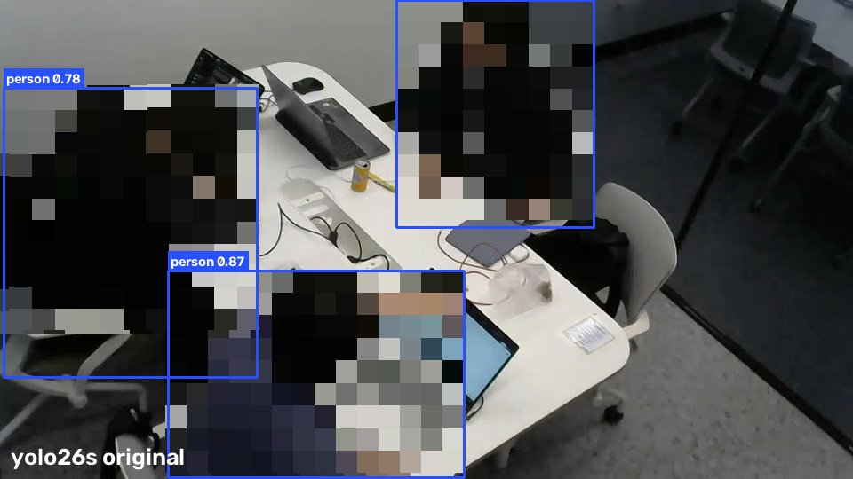
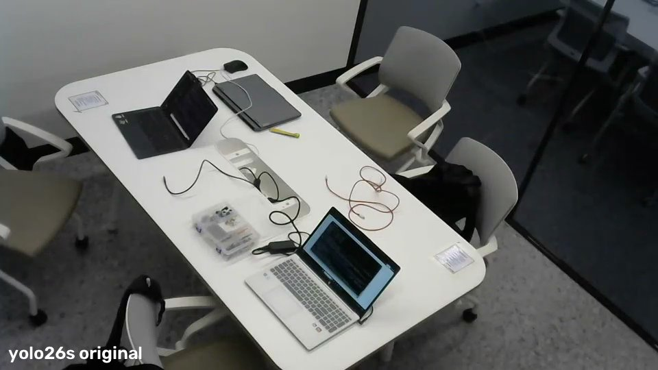

# finetune: 알박기용 YOLO26s 파인튜닝 모델 (v2)

사전학습 YOLO26s(COCO)를 우리 스터디룸 영상으로 추가 학습해, 사람(엎드린 사람 포함)과 테이블을 원본보다 잘 잡게 만든 가중치다. 클래스 번호와 이름은 COCO 80개 그대로라서 server.py에서 `--model`만 바꾸면 된다. 작성 황예성, 2026-10-20.

## server.py에서 쓰기

```bash
python server.py 1차.mp4 --zone zone_1차.json --interval 2 --log log.csv --model finetune/알박기_yolo26s_v2
```

- server.py가 `{model}.pt`로 열기 때문에 확장자 `.pt`는 빼고 쓴다.
- 입력 크기 960, 임계값 0.30 등 나머지 기본값은 그대로 둔다. 학습할 때도 입력 크기는 960이었다.
- 10_Project/.gitignore가 `*.pt`를 막고 있어서 이 파일 하나만 `git add -f`로 올렸다(20MB). .gitignore는 고치지 않았다.
- Ultralytics 8.4.176으로 학습했다. 이보다 낮은 버전에서는 파일을 못 열 수 있다.

### 팀 검증 명령으로 원본과 비교

위 명령을 두 모델로 돌린 결과다(2026-10-20, RTX 5060 Laptop, `--device 0`). 정답은 CLAUDE.md와 같다(0:00~3:30 사람 있음, 3:32~19:06 짐만 남음, 19:08 이후 사람 있음).

| 모델 | 빨강 | 노랑 | 정답과 다른 장 | 사람 있을 때 최저 | 3:30 프레임 | 학습에 안 쓴 구간 사람 최저 / 평균 | 빈 방 최고 | 마지막 엎드림 4장 |
|---|---|---|---|---|---|---|---|---|
| yolo26s (원본) | 189 | 470 | 2 | 0.43 | 0.43 | 0.52 / 0.90 | 0.10 미만 | 0.81~0.92 |
| 알박기_yolo26s_v2 | 189 | 470 | 2 | 0.77 | 0.86 | 0.78 / 0.95 | 0.10 미만 | 0.90~0.94 |

- 판정 결과는 원본과 같다. 정답과 다른 2장은 두 모델 모두 사람이 들어온 첫 프레임(0:00, 19:08)이고, 2프레임 연속 확인 규칙 때문이다.
- 달라진 것은 사람 신뢰도의 여유다. 사람이 있는 프레임의 최저값이 0.43에서 0.77로 올라 임계값 0.30과의 간격이 넓어졌다.
- **1차.mp4 앞 80%(0:00~17:34)는 학습에 썼다.** 그래서 전체 최저값과 3:30 프레임 값은 학습한 장면에서 잰 것이다. 학습에 쓰지 않은 구간은 17:34 이후 132장(사람 있는 85장)뿐이고, 표의 "학습에 안 쓴 구간" 열이 그 구간 값이다.
- CLAUDE.md에는 원본 26s가 MPS에서 빨강 188, 노랑 471(3:30 프레임 0.29)로 나온다고 되어 있다. 여기서는 CUDA로 돌렸고, 원본도 3:30 프레임이 0.43으로 나와 189/470이 되었다. 같은 프레임 값이 장치에 따라 달라진 것으로 보인다.

## 무엇을 했나

- 베이스: yolo26s.pt (COCO 사전학습)
- 학습 637장, 검증 90장
  1. 휴대폰으로 테이블 주변을 돌며 찍은 영상 18초에서 3프레임마다 1장씩 뽑은 181장. 테이블 박스는 테이블을 잘 잡는 모델 4개(yolo11l, yolo11m, yolov9s, rtdetr-l)로 후보를 만든 뒤 181장을 모두 눈으로 검수하고 틀린 것은 손으로 고쳤다. 사람과 물건 박스는 yolov10s 자동 라벨이다.
  2. 1차.mp4 앞 80%에서 2초마다 1장. 카메라가 고정이라 테이블 정답 박스 하나를 모든 프레임에 썼다. 사람과 물건 박스는 yolov10s 자동 라벨이다.
  3. 팀의 엎드린 사람 사진 6장. 비중을 늘리려고 3번씩 복사했다.
- 테이블은 물건이나 사람에 가려진 부분까지 포함해 전체를 박스로 그렸다. 클래스 번호는 COCO 그대로다(0 person, 60 dining table).
- 설정: epochs 25, imgsz 960, batch 8, AdamW, lr0 0.001, freeze 없음, seed 0. RTX 5060 Laptop에서 약 18분 걸렸다.
- 처음에는 사람 데이터 없이 테이블 위주로만 학습했다. 그러자 모델이 사람과 가방을 잊어버렸다(YOLO11s 기준 사람 100% → 68%, 가방 89% → 14%). 사람 데이터를 넣고 학습률을 낮춰 다시 학습한 것이 v2다.
- 같은 데이터로 YOLO11s, YOLO26m, YOLO26l도 학습했다. 시험 영상에서 사람과 테이블은 네 모델 모두 100%였고, 엎드린 사람은 26s가 100%, 11s가 98.8%였다. m과 l은 정확도 이득 없이 CPU에서 2.5~3.5배 느려서 26s를 골랐다.
- 학습 데이터(영상 프레임)에는 팀원 얼굴이 나와서 이 저장소에 올리지 않았다. 필요하면 팀 카톡방으로 받는다.

## 성능 (학습에 쓰지 않은 영상)

- 시험 A: 1차.mp4 뒤 20%. 2초마다 1장씩 131장이고, 마지막 7초에 엎드린 사람이 있다.
- 시험 B: 라즈베리파이 웹캠 영상 18초. 0.5초마다 1장씩 36장이다.
- 채점: 테이블은 신뢰도가 가장 높은 테이블 박스가 정답 박스와 IoU 0.5 이상이면 정답. 엎드린 사람은 엎드린 구간 84프레임 중 0.35 이상으로 잡은 비율. 사람과 물건은 화면에 실제로 있는 개수 중 잡은 비율(물건 0.25, 사람 0.35).

| 항목 | 원본 yolo26s | 알박기_yolo26s_v2 |
|---|---|---|
| 테이블 (A) | 2% (최고 0.27) | 100% (0.95) |
| 테이블 (B) | 0% | 100% (0.92) |
| 엎드린 사람 (A) | 92.9% | 100% |
| 앉은 사람 (B) | 100% | 100% |
| 노트북 / 휴대폰 / 마우스 (B) | 100 / 100 / 78% | 100 / 100 / 100% |
| 가방 (B) | 100% | 0% |

리소스(imgsz 960): 파라미터 10.0M, 52.6 GFLOPs, 파일 20MB. 1장에 GPU 29ms(RTX 5060 Laptop), CPU 155ms(노트북 CPU).

결과 화면(사람은 모자이크):

| 장면 | 원본 yolo26s | 알박기_yolo26s_v2 |
|---|---|---|
| 웹캠 (B) |  |  |
| 엎드림 (A) |  |  |
| 빈자리 (1차.mp4) |  |  |

## 팀 문서와 연결되는 부분

- **팀의 엎드린 사람 사진 6장은 v2 학습에 들어갔다.** CLAUDE.md의 "26s를 사진 6장으로 확인" 항목은 v2로는 확인할 수 없다. v2를 쓰려면 새 사진이나 실제 촬영으로 확인해야 한다.
- CLAUDE.md에는 COCO dining table을 15종 중 YOLO11l만 0.35 넘게 잡아서 감지 영역을 zone.py 다각형으로 직접 지정한다고 되어 있다. v2는 시험 영상 두 개에서 테이블을 모두 0.9 이상으로 잡는다. 다만 박스가 화면 축에 맞춰져 있어서, 대각선으로 보이는 테이블에서는 다각형보다 영역이 넓어진다(EXPERIMENTS.md 1절과 같은 문제).
- 가방은 거의 못 잡는다(B 0%). server.py는 사람(classes=[0])만 쓰므로 판정에는 영향이 없다. PRFAQ의 짐 검출(AWAY와 VACANT 구분)에는 이 모델을 쓰면 안 된다.

## 한계

- 시험 영상은 실제 고정 카메라 화면이지만 룸은 1곳이다. 다른 룸에 설치하면 그 카메라 화면으로 먼저 확인한다.
- 엎드린 사람 시험은 1명, 7초 분량이다. 후드나 모자, 얼굴을 카메라 쪽으로 둔 자세, 조명 변화는 보지 않았다.
- 사람과 물건 라벨은 yolov10s 자동 라벨이라 그 모델의 실수도 일부 배웠을 수 있다.
- 라즈베리파이에서의 속도와, NCNN 등으로 변환한 뒤의 정확도는 확인하지 않았다.

## 파일

| 파일 | 내용 |
|---|---|
| 알박기_yolo26s_v2.pt | 가중치 (20MB) |
| train_26.py | 학습 코드. s, m, l을 차례로 학습하며 v2는 s다. 경로는 학습한 노트북 기준이라 그대로는 안 돈다 |
| 학습기록/ | args.yaml(학습 설정), results.csv와 results.png(에폭별 손실과 mAP), 정규화한 혼동 행렬 |
| 결과화면/ | 원본과 v2의 검출 화면 (사람 모자이크) |
